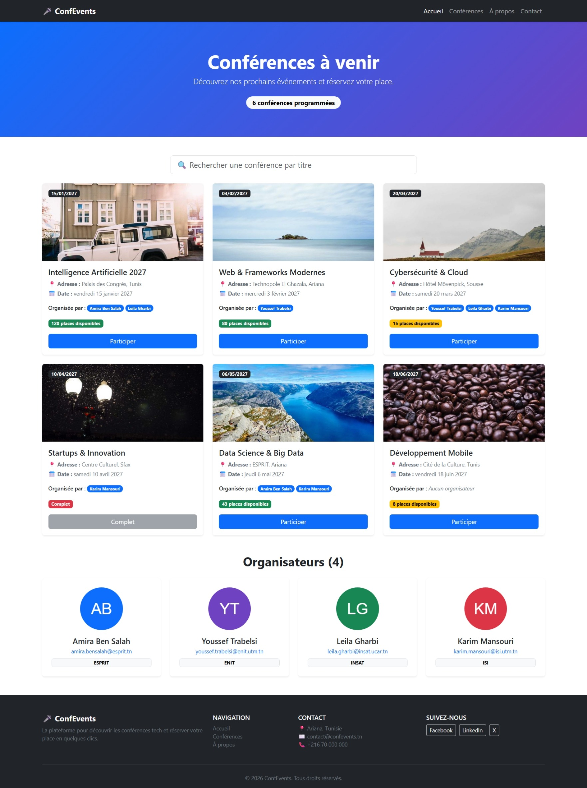

# ConfEvents – Ateliers Angular 21

Application Angular 21 + Bootstrap 5 de gestion de conférences, réalisée dans le cadre des ateliers du cours Angular.

## Aperçu



## Atelier 1 – Composants & Signals

- Création des composants **Header**, **Footer** et **Home**, appelés dans le composant racine
- Liste statique de conférences (`picture`, `title`, `date`, `adress`, `available_Places`)
- Design basé sur **Bootstrap** et footer finalisé

## Atelier 2 – Les organisateurs des conférences

- Classe modèle **`Organizer`** (`id`, `name`, `email`, `picture`, `university`)
- Composant **`OrganizerList`** : affichage des organisateurs sous forme de cards
- Champ **`organizers: Organizer[]`** ajouté au modèle `Conference`
- Affichage « **Organisée par :** » sous chaque conférence (`@for` imbriqué)
- Cas vide géré avec `@empty` : « **Aucun organisateur** »
- Bonus : nombre d'organisateurs dans le titre et email cliquable (`mailto:`)

## Fonctionnalités du cours (data binding)

- **Recherche par titre** : two-way binding avec `[(ngModel)]`
- **Bouton Participer** : event binding avec `(click)`, qui décrémente les places disponibles

## Notions utilisées

| Notion | Où |
|---|---|
| Composants standalone (`ng g c`) | `header`, `footer`, `home`, `organizer-list` |
| Signals (`signal()`, `computed()`, `update()`) | liste des conférences, recherche, participation |
| Interpolation `{{ }}` | titres, adresses, places, noms |
| Property binding `[src]`, `[alt]`, `[href]`, `[class.x]` | images, emails, badges |
| Event binding `(click)` | bouton Participer |
| Two-way binding `[(ngModel)]` | champ de recherche |
| Control Flow `@for`, `@if / @else`, `@empty` | cartes, organisateurs, cas vides |
| Pipe `date` (locale fr-FR) | dates des conférences |

## Structure

```
src/app/
├── components/
│   └── organizer-list/      # cards des organisateurs
├── data/
│   └── organizers.ts        # liste des organisateurs
├── models/
│   ├── conference.ts        # classe Conference
│   └── organizer.ts         # classe Organizer
├── pages/
│   └── home/                # conférences + recherche + participation
├── shared/
│   ├── header/              # barre de navigation
│   └── footer/              # pied de page
├── app.ts / app.html        # composant racine
└── app.config.ts            # locale française

public/images/organizers/    # photos des organisateurs
```

## Technologies

- Angular 21
- Bootstrap 5.3
- TypeScript

## Lancer le projet

```bash
npm install
ng serve
```

Puis ouvrir http://localhost:4200/